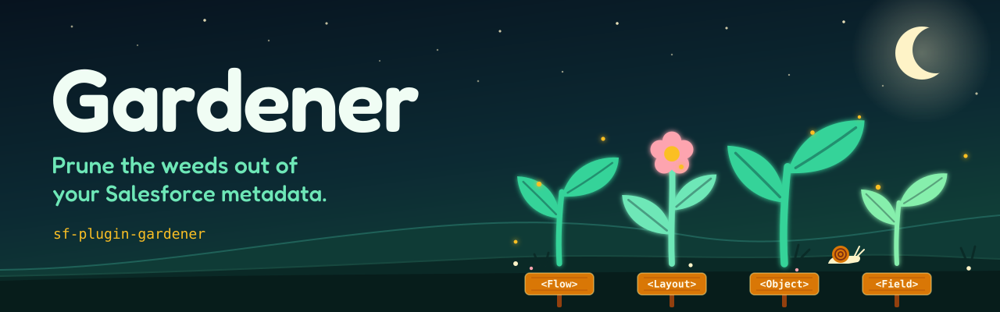

# Gardener

Gardener is a Salesforce CLI plugin that lints the metadata of Salesforce DX projects.

It reads the metadata files of a project and reports what fails at deploy, exposes data or breaks a platform limit. It works offline, never connects to an org and never parses source code. [Core concepts](https://zaclummys.github.io/sf-plugin-gardener/concepts/) explains what is in scope.

## Status

Gardener is under development and is not published yet. The design and the rules catalog are written, and the code is a skeleton. The catalog marks each rule as planned or implemented.

## Documentation

The documentation is published at https://zaclummys.github.io/sf-plugin-gardener/.

- [Core concepts](https://zaclummys.github.io/sf-plugin-gardener/concepts/): scope, the project and how the analysis works.
- [Configure](https://zaclummys.github.io/sf-plugin-gardener/configuration/): the configuration file and how rules are enabled.
- [Presets](https://zaclummys.github.io/sf-plugin-gardener/presets/): the rules enabled by `recommended`.
- [Rules](https://zaclummys.github.io/sf-plugin-gardener/rules/): every rule, grouped by metadata type.
- [Architecture](https://zaclummys.github.io/sf-plugin-gardener/architecture/): how the plugin is built.

The source lives in [docs](docs) and is built with Eleventy. To read it locally:

```sh
npm install
npm run docs:dev
```

Then open http://localhost:8080/.

## Development

```sh
npm install
npm run build
```

`npm run build` compiles the plugin and lints the repository.

## License

BSD-3-Clause. See [LICENSE.md](LICENSE.md).
